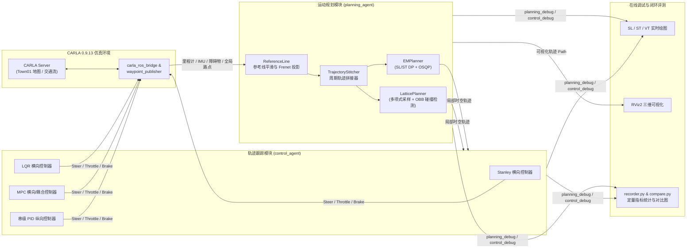
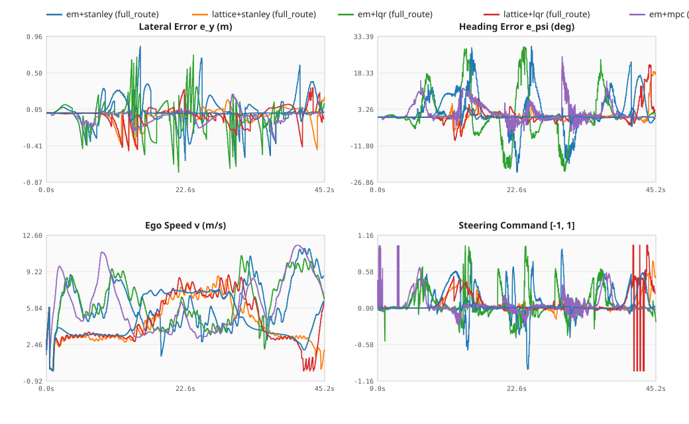
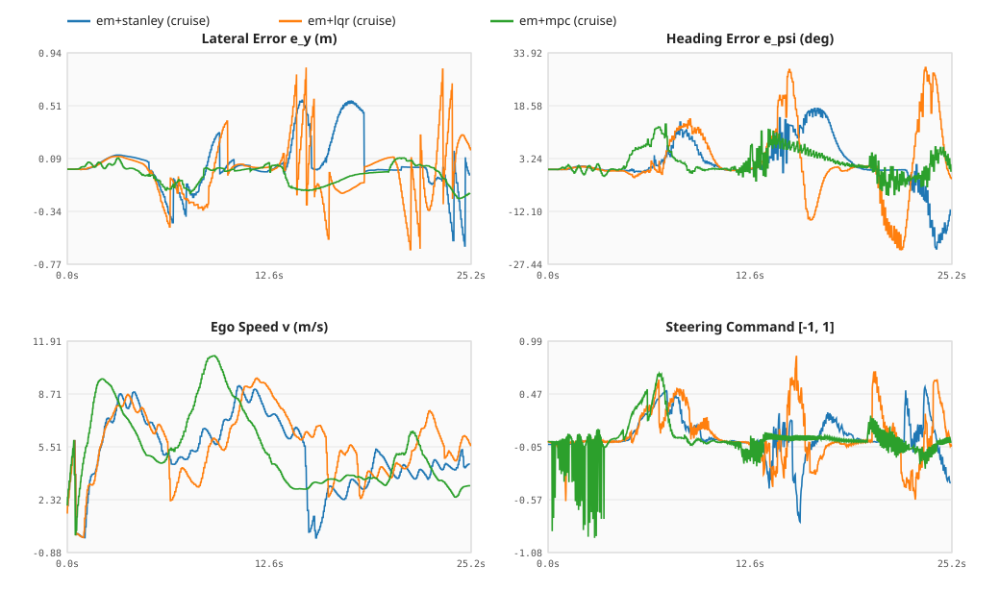

# carla-ros2-pnc

基于 **CARLA 0.9.13 + ROS2 Foxy + C++17** 构建的模块化自动驾驶运动规划与轨迹跟踪控制（PnC）系统。系统采用解耦式规划控制架构，支持 **`EMPlanner` / `LatticePlanner`** 双规划器与 **`Stanley` / `LQR` / `MPC`** 多控制器在线参数化切换，配套 Frenet SL/ST/VT 实时可视化调试器、Docker 容器化编译运行管线以及确定性闭环定量评测框架。

---

## 一、核心功能特性

- **模块化双规划器架构**
  - **统一规划抽象与轨迹拼接**：基于纯 C++ `PlannerBase` 抽象接口与 `TrajectoryStitcher` 周期轨迹拼接器，通过前向时间投影保障重规划帧间的状态连续性与控制平滑性，在状态大偏差或冷启动时自动回退至运动学外推初始化。
  - **`EMPlanner`（路径-速度解耦规划）**：基于参考线平滑与 Frenet 坐标系投影，结合动态规划（DP）通道搜索与 OSQP 分段五次多项式二次规划（QP）生成平滑避障路径及速度剖面。
  - **`LatticePlanner`（横纵向轨迹网格采样规划）**：采用五次/四次多项式横纵向解耦采样（含障碍物前缘锚定动态横向跨度）、`0.1 s` 粗筛 + `0.02 s` 加密两阶段运动学约束校验、基于二维有向包围盒分离轴定理（2D OBB SAT）的碰撞检测，以及六维无量纲代价函数最小堆优选与安全横向保持回退机制。
- **多控制器闭环跟踪矩阵**
  - **横向控制**：支持 **`Stanley`**（前轴几何横向误差非线性反馈 + 路径曲率前馈 + 一阶低通转向滤波）、**`LQR`**（基于自行车动力学模型的离散时间线性二次型调节器 + 曲率前馈）、**`MPC`**（基于 OSQP-Eigen 求解器的滚动时域模型预测控制）。
  - **纵向控制**：采用位置-速度串级 PID 控制器，与横向控制器协同输出油门、制动与转向控制指令。
- **在线诊断与实时可视化**
  - 实时发布 `/carla/ego_vehicle/planning_debug` 与 `/carla/ego_vehicle/control_debug` 结构化诊断数据，支持 RViz2 三维局部轨迹渲染及 `planning_debug_plotter.py` 在线绘制 **SL 避障走廊、ST 时间-距离障碍图与 VT 速度规划曲线**。
- **确定性闭环评测与多算法对比流水线**
  - 提供无头（Headless）与图形（GUI）双模式闭环测试入口，固定自车与场景障碍物初始状态，自动采集全周期横向误差、航向误差、速度跟踪误差、纵向急动度（Jerk）、方向盘转角速率、障碍物最小净空、碰撞次数以及规划/控制单帧耗时（Mean / P95），一键生成多算法 Markdown 指标对比表与 SVG 矢量曲线图。
- **容器化工程工具链**
  - 宿主机无需直接安装 ROS2 Foxy，通过根目录统一入口脚本 `project.sh` 一键驱动开发容器增量编译、多场景仿真（静态双车占道绕行、同车道慢车跟驰、路口动态横穿交互）及离线 Town01 交互式坐标选点工具。

---

## 二、系统架构



---

## 三、闭环定量评测基准

### 1. 全路线 `2 规划器 × 3 控制器` 闭环矩阵测试（`full_route`，45 s）

测试路线覆盖 Town01 首个 90° 路口转弯、直道连续两台路侧占道静态障碍车（85 m 与 115 m 处）绕行避障、并道回正及第二个 90° 弯道，6 组算法组合均实现 **零碰撞（Collisions = 0）** 稳定通行：

| 评测指标 | `em + stanley` | `lattice + stanley` | `em + lqr` | `lattice + lqr` | `em + mpc` | `lattice + mpc` |
|---|---|---|---|---|---|---|
| 行驶里程 (m) | 215.45 | 164.89 | 222.07 | 166.86 | 217.50 | 176.53 |
| 碰撞次数 | **0** | **0** | **0** | **0** | **0** | **0** |
| 最小障碍物中心距 (m) | 3.04 | 2.51 | 3.04 | 2.40 | 2.32 | 3.17 |
| 横向误差 RMSE (m) | 0.182 | 0.108 | 0.186 | 0.126 | **0.088** | 0.106 |
| 最大横向误差 (m) | 0.836 | 0.469 | 0.744 | 0.475 | **0.326** | 0.600 |
| 航向误差 RMSE (°) | 7.05 | **2.91** | 9.15 | 3.50 | 4.52 | 4.69 |
| 速度跟踪误差 RMSE (m/s) | 0.730 | **0.577** | 0.745 | 0.797 | 0.865 | 0.675 |
| 纵向急动度 Jerk RMS ($\text{m/s}^3$) | 42.74 | 28.17 | 38.31 | 48.26 | 21.06 | **16.69** |
| 方向盘转角速率 RMS (1/s) | 1.976 | **0.456** | 3.239 | 5.040 | 4.944 | 0.858 |
| 规划单帧耗时 Mean / P95 (ms) | 18.50 / 29.27 | 19.88 / 33.15 | 18.35 / 29.17 | 19.41 / 33.56 | 18.64 / 30.03 | 19.42 / 33.54 |
| 控制单帧耗时 Mean / P95 (ms) | **0.11 / 0.16** | **0.11 / 0.16** | 1.64 / 2.40 | 2.71 / 10.67 | 3.55 / 5.35 | 3.62 / 5.58 |



### 2. 三种横向控制器巡航跟踪对比（`cruise` 场景，固定 `EMPlanner`）



**工程特征小结**：
- **横向跟踪精度与舒适性**：`MPC` 凭借滚动时域预测与控制增量约束，在两组规划器下均取得约 `0.09 m ~ 0.11 m` 的横向误差 RMSE 与最低的纵向急动度；
- **实时计算开销**：`Stanley` 单步控制耗时仅 `0.11 ms`（约为 `MPC` 的 1/30），配合前馈与转向低通滤波，在 `LatticePlanner` 平滑五次多项式轨迹上取得了 `0.456 /s` 的极低方向盘抖动率；
- **规划耗时稳定性**：`EMPlanner` 与两阶段筛查优化后的 `LatticePlanner` 单帧平均耗时均稳定在 `18.3 ms ~ 19.9 ms`（P95 < `34 ms`），满足 `20 Hz`（`50 ms` 周期）实时规控闭环预算。

---

## 四、仓库目录结构

```text
carla-ros2-pnc/
├── project.sh                          # 统一命令行入口（编译 / 仿真 / 评测 / 对比 / 场景控制）
├── work/
│   ├── controller-dev/                 # ROS2 增量开发工作区与源码挂载目录
│   │   ├── build-from-host.sh          # 宿主机一键触发容器内 Colcon 编译脚本
│   │   └── src/my_planning_and_control/
│   │       ├── general_modules/        # 公共数据结构、Frenet 坐标转换、多项式工具
│   │       ├── planner_modules/        # PlannerBase、TrajectoryStitcher、EMPlanner、LatticePlanner
│   │       ├── controller_modules/     # Stanley、LQR、MPC 横向控制器与串级 PID 纵向控制器
│   │       └── main_function/          # PlanningAgent、ControlAgent 节点、Launch 与实时绘图脚本
│   └── container/                      # Docker 构建配置、RViz 视图、场景配置与自动化评测编排脚本
├── experiments/
│   ├── eval/                           # 闭环评测采集器 (recorder.py) 与对比图表生成器 (compare.py)
│   ├── benchmarks/                     # 多算法闭环对比指标表 (.md) 与矢量曲线图 (.svg)
│   └── following/                      # 同车道慢速前车跟驰诊断场景配置
└── maps/
    └── town01/                         # CARLA Town01 离线矢量地图与浏览器交互式坐标选点工具
```

---

## 五、快速开始

### 1. 环境依赖
- Ubuntu 宿主机 + Docker + NVIDIA Container Toolkit（支持 GPU 渲染与 CARLA 0.9.13 容器运行）
- 已导入或构建以下基础镜像：
  - `carlasim/carla:0.9.13`
  - `codex-carla-foxy:project-gui`（依赖构建定义见 [`work/container/Dockerfile`](work/container/Dockerfile) 与 [`work/container/Dockerfile.gui`](work/container/Dockerfile.gui)）

### 2. 编译规控源码

```bash
# 启动常驻开发容器（首次运行或重启宿主机后执行一次）
bash project.sh dev

# 在容器内执行增量编译（Colcon build）
bash project.sh build
```

### 3. 启动 GUI 可视化闭环仿真与在线切换算法

默认启动 `EMPlanner + MPC`，自动拉起 CARLA 服务端、ROS2 Bridge、RViz2 与车辆跟随视角窗口：

```bash
bash project.sh run
```

通过环境变量一键切换任意 **`planner_type`（`em` | `lattice`）** 与 **`controller_type`（`stanley` | `lqr` | `mpc`）** 组合：

```bash
# 示例 1：使用 Lattice 规划器 + Stanley 控制器
PNC_PLANNER_TYPE=lattice PNC_CONTROLLER_TYPE=stanley bash project.sh run

# 示例 2：使用 Lattice 规划器 + MPC 控制器
PNC_PLANNER_TYPE=lattice PNC_CONTROLLER_TYPE=mpc bash project.sh run

# 示例 3：使用 EM 规划器 + LQR 控制器
PNC_PLANNER_TYPE=em PNC_CONTROLLER_TYPE=lqr bash project.sh run
```

仿真运行期间常用交互控制命令：

```bash
bash project.sh pause              # 暂停仿真时钟
bash project.sh step               # 单步推进一帧
bash project.sh play               # 恢复连续运行
bash project.sh traffic run        # 启动前方背景车动态行驶
bash project.sh crossing yield     # 触发路口横穿车辆让行测试场景
bash project.sh stop               # 停止并清理全部仿真容器
```

在容器终端中打开 SL / ST / VT 实时规划调试曲线窗口：

```bash
bash project.sh ros
ros2 run my_pnc planning_debug_plotter.py
```

### 4. 运行自动化闭环定量评测与生成对比报告

```bash
# 单组无头确定性闭环评测（输出 summary.json 与 timeseries.csv）
bash project.sh eval --planner lattice --controller mpc --scenario full_route --duration 45 --headless

# 多组评测结果自动汇总生成 Markdown 指标表与 SVG 对比图
bash project.sh compare \
  experiments/eval/runs/<run_dir_1> \
  experiments/eval/runs/<run_dir_2> \
  --out experiments/eval/runs/custom_comparison
```

### 5. 离线交互式场景坐标选点工具

直接在浏览器中打开 [`maps/town01/town01-map.html`](maps/town01/town01-map.html)，可离线查看 CARLA Town01 车道中心线、全局参考路线及路点航向角，点击任意位置即可复制对应的 CARLA / ROS2 坐标用于配置自定义障碍物场景。
